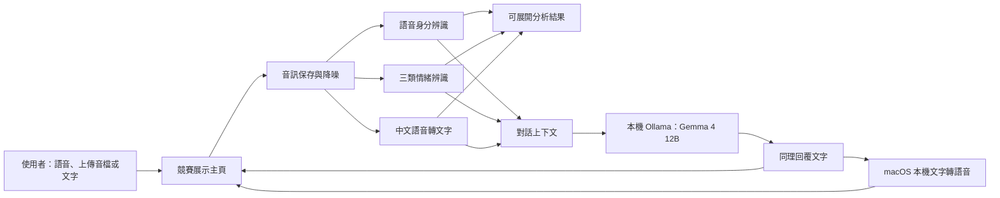

# 聲緒聊天助理：競賽展示主頁設計

**日期：** 2026-09-27  
**狀態：** 使用者已確認設計，待規格複核後進入實作規劃。

## 目標

為「具備身分辨識跟情緒感知的聊天機器人」建立一個適合競賽影片與現場展示的主頁。主頁以對話為中心，將語音身分辨識、情緒辨識、中文轉寫與本機大型語言模型整合成可理解的體驗；既有頁面則保留為模型管理與訓練後台。

成功標準：第一次語音互動能顯示辨識身分並以名字自然問候；後續回覆能參考對話脈絡與情緒線索；評審能展開查看分析與校正資料；所有推論在本機端完成。

## 已確認的使用體驗

### 歡迎頁

- 主標題：「聲緒聊天助理」。
- 副標題：「聽見你的情緒，用更貼近你的方式陪你對話。」
- 單一主要動作：「開始聊天」。
- 視覺採溫暖陪伴感：米白、暖灰、低飽和暖橘與粉紫，柔和圓角與留白。

### 聊天室

- 輸入列同時提供錄音、上傳音檔與文字輸入。
- 首次由語音辨識到已註冊成員時，頂端固定顯示「目前使用者：姓名」，助理以「姓名你好，今天想聊些什麼？」開始對話。
- 語音模型信心不足時，固定顯示「目前使用者：未知使用者」，助理不得猜測或誤稱姓名。
- 平時只顯示目前使用者與目前情緒；「查看這次語音分析」折疊面板才顯示三類情緒百分比、中文轉寫與人工校正。
- 助理有固定療癒感 AI 頭像。每則助理回覆附「播放回覆」按鈕。
- 語音回覆預設溫柔女聲，使用者可以切換至中性聲線。
- 支援 macOS 深色模式；深色模式採暖深灰與暖紫，不使用純黑。

### 對話原則

- 先理解與陪伴使用者感受，再自然追問；除非使用者明確希望，避免一開始就提出解法。
- 語音情緒結果只用作語氣線索，不能當成使用者感受的事實。
- 聊天狀態在單次瀏覽期間保留最近對話脈絡；「清除這次對話」只清空該對話，不刪除訓練或分析資料。

## 系統架構

### 模組邊界

| 元件 | 職責 | 介面與資料 |
|---|---|---|
| 展示主頁 | 歡迎頁、聊天室、狀態與可展開分析 | 呼叫既有整合分析與聊天函式，不直接讀寫訓練模型 |
| 整合分析服務 | 保存音檔、降噪、身分、情緒、轉寫 | 回傳 `CombinedAnalysis`，並保存原始分析紀錄 |
| 本機聊天服務 | 將分析線索與近期對話送入 Ollama | 僅連線 `127.0.0.1` 或 `localhost` 的 Ollama |
| macOS 語音回覆 | 以兩個可切換的內建語音播放助理回覆 | 只接收助理文字，不處理訓練資料 |
| 模型管理與訓練後台 | 訓練、校正、撤回、檢視資料與模型指標 | 保持既有功能，從展示主頁以明確入口開啟 |

## 模型與來源限制

競賽規則禁止使用中國或中資來源的開源模型、API、MCP 或其他介接工具進行訓練與推論。本作品固定採用下列已核對來源的元件：

| 功能 | 元件 | 來源 |
|---|---|---|
| 中文轉寫 | OpenAI Whisper (`small`) | OpenAI，MIT |
| 對話 | Gemma 4 12B（本機 Ollama） | Google |
| 聲音特徵 | `facebook/wav2vec2-xls-r-300m` | Meta，Apache-2.0 |
| 聲紋 | `speechbrain/spkrec-ecapa-voxceleb` | SpeechBrain，Apache-2.0 |
| 情緒分類 | 使用者團隊自行訓練的 scikit-learn 分類器 | 團隊資料與訓練結果 |
| 繁體轉換與回覆語音 | macOS 內建能力 | Apple 本機系統元件 |

不得加入 emotion2vec、SenseVoice、Qwen、DeepSeek 或其他來源或中資背景不符合規則的模型與介接工具。所有模型名稱、版本、來源與授權應在競賽文件中揭露。

## 繁體中文與語音回覆

- Whisper 原始輸出先保存，接著使用 macOS 本機能力轉換為繁體中文供主頁顯示與校正。
- 轉換不得更動保存的原始辨識文字；校正後逐字稿仍優先用於聊天。
- 使用瀏覽器可播放的本機語音回覆，預設溫柔女聲，提供中性聲線切換；若系統語音無法使用，文字回覆不得受影響，並顯示可理解的錯誤訊息。

## 錯誤與隱私

- 模型未完成訓練、語音過短、轉寫失敗或 Ollama 未啟動時，顯示下一步操作而非技術堆疊訊息。
- 未知聲音不寫入既有成員的聲紋資料；更正前不會更新任何訓練模型。
- 音檔、分析結果、校正與模型檔案僅存於桌面「專題研究」資料夾與本機專案，不傳送至外部服務。

## 驗證

1. 以四位註冊成員與未知聲音測試頂端身分顯示與首句問候。
2. 以正面、負面、平靜語句驗證情緒簡潔卡片與折疊分析分數。
3. 以繁體中文錄音驗證顯示繁體文字、原始結果留存與人工校正。
4. 驗證兩輪失戀情境：第一輪先同理追問，第二輪能使用前文回覆。
5. 驗證溫柔女聲與中性聲線都能播放；無法播放時不影響文字聊天。
6. 驗證全程在未連網狀態下，使用已快取模型、本機 Ollama 與本機資料完成推論。
